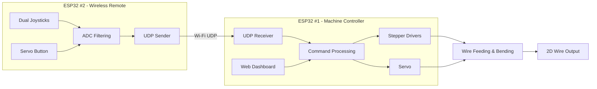
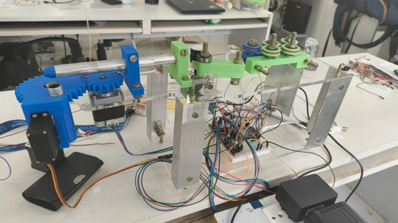

# ⚙️ AVISHKAR26-2511985897-Bendbotics
### Wireless Dual-Mode Automated 2D Wire-Bending Prototype

**Event:** AVISHKAR'26 – 24-Hour Hackathon  
**Institute:** Adichunchanagiri Institute of Technology, Chikkamagaluru  
**Domain:** Embedded Systems & IoT  
**Team ID:** AV26-2511985897  
**Team Name:** Bendbotics

---

## 🚀 About Bendbotics

Bendbotics is a wireless, automated 2D wire-bending prototype developed to make repetitive wire-bending operations simpler and more consistent.

In small construction sites and fabrication workshops, workers often bend metal wires manually to create shapes such as square and rectangular stirrups. This process takes time, requires physical effort and makes it difficult to maintain consistent bending angles.

We wanted to explore how this work could be automated without depending on expensive industrial machinery.

Our solution uses two ESP32 controllers, NEMA 17 stepper motors, DRV8825 drivers and a servo-operated bending pin. It supports both automatic shape generation and wireless manual operation.

### What can Bendbotics do?

- **Automatic Mode:** Produces four predefined shapes – Triangle, Square, Hexagon and Octagon.
- **Manual Mode:** Allows real-time feeding and bending control using a wireless dual-joystick remote.
- **Web Dashboard:** Provides a browser-based interface for machine operation.
- **Wireless Communication:** Connects the handheld remote to the machine without physical control cables.

---

## 🎯 1. The Problem

Manual wire bending is still widely used in smaller construction and fabrication workshops.

Workers have to repeatedly measure, feed and bend wires to achieve the required shapes. Apart from taking time, maintaining consistent angles and dimensions across multiple pieces can be challenging.

Industrial CNC wire-bending machines can automate this process, but their cost and infrastructure requirements make them difficult for smaller workshops to access.

**Our goal was to build a compact and affordable prototype that demonstrates automated wire bending while retaining the flexibility of manual operation.**

## 💡 2. Our Approach

We divided the control system between two ESP32 microcontrollers.

| Controller | Main Function |
|---|---|
| ESP32 #1 | Machine operation, motors, servo and web dashboard |
| ESP32 #2 | Wireless joystick inputs and command transmission |

The two controllers communicate through Wi-Fi UDP.

The machine can be operated in two ways:

1. Select a predefined shape through the web dashboard for automatic bending.
2. Use the handheld joystick remote to control feeding and bending manually.

This gives the operator both preset automation and direct control.

## ⭐ 3. Key Features & Engineering Challenges

During development, we worked on several practical challenges involved in making the machine operate reliably.

**1. Dual-ESP32 Wireless Communication**

- Wi-Fi communication using UDP on port 4210.
- 40 ms command update interval.
- Automatic local network discovery using mDNS.
- Machine access through `http://wirebender.local`.

**2. Springback Compensation**

One challenge in wire bending is springback. After bending, the wire tends to partially return towards its original position because of its elasticity.

To handle this, we tested different motor movements and developed experimentally calibrated step profiles. These also account for mechanical pin clearance.

**3. Triangle Reverse-Homing Sequence**

The triangle preset requires a different movement sequence. The bending arm first moves to a position that clears the wire-feeding path. After the wire advances, the bending pin engages and the arm completes the 120° bend while returning towards its home position.

**4. Motor Control & Electrical Noise**

- Active-LOW DRV8825 Enable pin control.
- Motor driver lockout when idle.
- Servo PWM detached while parked to reduce unwanted electrical interference.

**5. Wireless Safety & Input Reliability**

| Feature | Implementation |
|---|---|
| ADC Filtering | 10× oversampling |
| Joystick Calibration | Automatic after Wi-Fi connection |
| Button Debouncing | 60 ms |
| Signal Loss Protection | 300 ms auto-stop |
| Emergency Stop | Web dashboard control |

These measures help reduce unwanted input variations and prevent continued operation when wireless communication is lost.

---

## 🏗️ 4. System Architecture

The system has two independent ESP32 controllers connected through Wi-Fi UDP communication.

The handheld remote sends joystick and button information to the machine controller. The main controller processes these commands and operates the motors and servo.



### Communication Specifications

| Parameter | Configuration |
|---|---|
| Protocol | Wi-Fi UDP |
| UDP Port | 4210 |
| Update Interval | 40 ms |
| Discovery | mDNS |
| Hostname | wirebender.local |
| Packet Format | `feedSpd,bendSpd,pinBtn` |

---

## 📐 5. Automatic Shape Generation

The current prototype supports four predefined geometric shapes.

Each shape uses a different calibrated bending movement. We adjusted the motor travel experimentally to obtain the required bends instead of relying only on theoretical angles.

### Calibrated Bending Profiles

| Shape | Bend Angle | Feed Steps | Bend Steps |
|---|---:|---:|---:|
| Triangle | 120° | 420 | 700 |
| Square Stirrup | 90° | 420 | 680 |
| Hexagon | 60° | 220 | 600 |
| Octagon | 45° | 220 | 560 |

### Bending Sequence

| Shape | Operation |
|---|---|
| Triangle | Pre-position → Feed → Engage pin → Bend towards home |
| Square | Feed → Lift pin → Bend → Return home → Lower pin |
| Hexagon | Feed → Lift pin → Bend → Return home → Lower pin |
| Octagon | Feed → Lift pin → Bend → Return home → Lower pin |

*Note: These are experimentally calibrated step profiles used in the current prototype.*

---

## 🔌 6. Hardware & Pin Configuration

The hardware is divided into the main machine controller and the wireless remote.

### ESP32 #1 – Machine Controller

| Component | GPIO |
|---|---:|
| Feeder STEP | 5 |
| Feeder DIR | 18 |
| Feeder EN | 25 |
| Bender STEP | 19 |
| Bender DIR | 21 |
| Bender EN | 27 |
| Bending Servo PWM | 23 |

**Additional Hardware Details**
- DRV8825 drivers with 100 µF decoupling capacitors across VMOT and GND.
- Active-LOW Enable control for motor lockout.
- Servo positioning: 400 µs (UP), 1050 µs (DOWN).
- 12V and 5V power rails.
- Common logic ground shared with the motor drivers.

### ESP32 #2 – Wireless Remote

| Component | GPIO |
|---|---:|
| Joystick 1 (VRy) | 35 |
| Joystick 2 (VRx) | 34 |
| Servo Button | 26 |
| Status LED | 2 |

**Additional Hardware Details**
- Both joysticks powered at 3.3V.
- GPIO 34 and GPIO 35 used as ADC inputs.
- External 10 kΩ pull-up for the button with `INPUT_PULLUP`.
- Isolated USB power bank for the handheld remote.
- Onboard LED indicates successful Wi-Fi connection and ADC calibration.

---

## 💻 7. Software & Technologies

The firmware is written in Arduino C++ with libraries for motor movement, servo operation and wireless communication.

| Technology | Purpose |
|---|---|
| Arduino C++ | Embedded programming |
| ESP32 | Microcontroller |
| WiFi / WiFiUDP | Wireless communication |
| WebServer | Web dashboard |
| ESPmDNS | Local network discovery |
| AccelStepper | Stepper motor control |
| ESP32Servo | Servo control |
| HTML / CSS / JavaScript | Web interface |
| Onshape | Mechanical CAD design |

---

## 🧩 8. 3D CAD Model

We designed the mechanical assembly of Bendbotics using **Onshape**, a browser-based parametric CAD platform.

The CAD model represents the wire-feeding assembly, bending head and overall mechanical arrangement of the prototype.

### 🔗 [CLICK HERE TO VIEW THE COMPLETE 3D CAD MODEL](https://cad.onshape.com/documents/7ffdfa73777757525051c5d41/w/1624b78c90de63c5ce5b895b/e/67fd57bd74c8c72f385b496f?renderMode=0&uiState=6b07b15ba3f943f7327fa826)

Open the link to explore the mechanical design directly in Onshape.

---

## 📁 9. Repository Structure

```text
AVISHKAR26-2511985897-Bendbotics/
│
├── Esp-1 (for pre set shapes)/
│   └── Automatic wire-bending program
│
├── Esp-2(manual control)/
│   └── Wireless joystick control program
│
└── README.md
```

---

## ⚙️ 10. Setup & Running Instructions

### Requirements

- Arduino IDE 2.x
- ESP32 board support package
- Two ESP32 development boards
- NEMA 17 stepper motors and DRV8825 drivers
- Servo motor and two analog joysticks

### Required Libraries

Install these libraries through Arduino IDE Library Manager:

- AccelStepper – Mike McCauley
- ESP32Servo – Kevin Harrington & John K. Bennett

WiFi, WebServer, ESPmDNS and WiFiUDP are included with the ESP32 Arduino Core.

### Step 1 – Configure Wi-Fi

Update the credentials in both ESP32 sketches:

```cpp
const char* ssid = "YOUR_WIFI_SSID";
const char* password = "YOUR_WIFI_PASSWORD";
```

Do not upload actual Wi-Fi passwords to a public repository.

### Step 2 – Upload the Machine Controller

Connect ESP32 #1 to your computer, select ESP32 Dev Module and the correct COM port, and upload the machine controller program.

Check the Serial Monitor for the network connection and IP address.

### Step 3 – Upload the Wireless Remote

Connect ESP32 #2 and upload the joystick remote program.

Keep both joysticks untouched during initial calibration. Power the remote using an isolated USB power bank and wait for the onboard LED to turn solid.

### Step 4 – Start Operating

Connect your phone or laptop to the same Wi-Fi network and open:

`http://wirebender.local`

Alternatively, use the IP address displayed in the machine controller's Serial Monitor.

Select Automatic Presets or Manual Joystick mode to operate the machine.

---

## 🔮 11. Future Scope

There are several improvements we would like to explore as we continue developing Bendbotics.

| Area | Planned Improvement |
|---|---|
| Custom Shapes | User-defined dimensions and bend angles |
| Batch Production | Quantity-based automated production |
| Precision | Rotary encoder feedback |
| Wire Detection | Automatic wire-jam and wire-end detection |
| Cutting | Integrated wire-cutting mechanism |
| Advanced Bending | Multi-axis bending capabilities |
| Industrial Scaling | Higher-torque motors, industrial drivers and reinforced bending head |

Our long-term aim is to explore how this concept can be developed into an affordable and adaptable wire-fabrication platform for smaller workshops.

*Industrial-scale operation would require further mechanical, electrical and safety validation.*

---

## 📜 12. Open-Source Resources & Licenses

| Resource | License |
|---|---|
| Arduino-ESP32 Core | LGPL-2.1 |
| AccelStepper | GPL-3.0 |
| ESP32Servo | LGPL-2.1 |

Refer to the respective library repositories for their original license terms.

## Project Preview



## Project Demonstration
[▶ Watch Project Demonstration](./Working%20video.mp4)
---

<p align="center">
  <b>BENDBOTICS</b><br>
  <i>Designed to Bend. Built to Innovate.</i><br><br>
  AVISHKAR'26 | Embedded Systems & IoT
</p>


